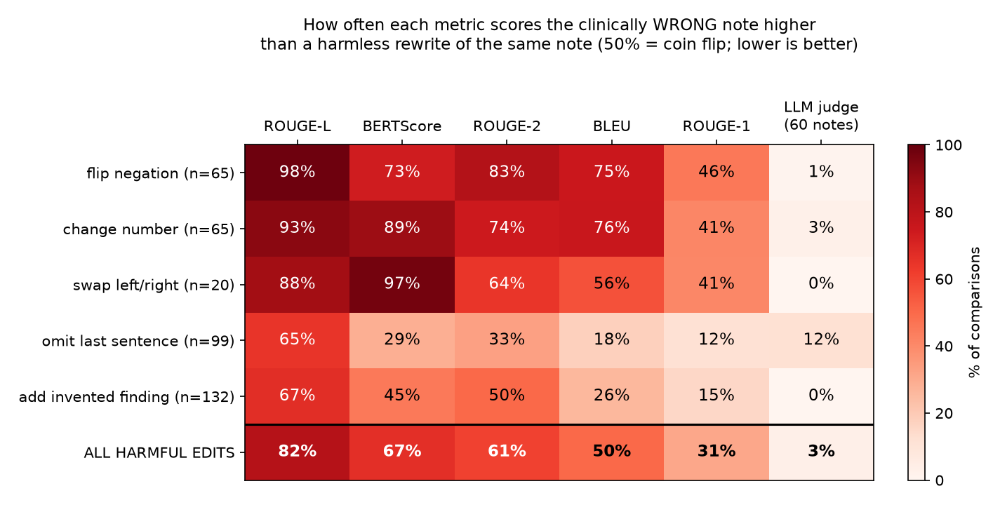

# When Do Summary Metrics Mislead? A Stress Test on Clinical Notes

**Question:** BLEU, ROUGE, BERTScore and LLM-as-judge are the standard ways to evaluate generated clinical notes. When does each one give the wrong answer?

Using clinical note sections written by clinicians from doctor-patient conversations (MTS-Dialog), this project (1) makes small, controlled edits that either keep or change the clinical meaning and checks which metrics notice, and (2) compares each metric with human factual judgments of 400 model-generated summaries.

## In short

- **Overlap and embedding metrics often prefer the clinically wrong note.** Given a harmful edit and a harmless rewrite of the same note, ROUGE-L scored the harmful one higher 82% of the time, BERTScore 67%, BLEU 50% (a coin flip). With a flipped negation ("does smoke" instead of "does not smoke"), ROUGE-L was wrong 98% of the time.
- **BERTScore is not a fix for factual errors.** It handles paraphrase well, but scored a left/right swap 99 out of 100 and preferred it over a harmless rewrite 97% of the time: "left" and "right" sit close together in embedding space.
- **An LLM judge (Claude, 1-5 clinical accuracy rubric) was the only metric that reliably caught the edits** (wrong in 3% of comparisons) and the one that best tracked human factual F1 on real summaries (Spearman 0.62, vs 0.55 for BERTScore and 0.36 for ROUGE-L).
- **No metric detected hallucinations in real model summaries well.** As a detector of summaries with at least one invented fact, overlap metrics were at chance (AUROC 0.47 to 0.52), BERTScore 0.61, the LLM judge 0.66. An automatic metric alone is not enough to sign off on clinical text.

## Results: controlled edits

132 note sections from the MEDIQA-Chat 2023 test set (sections with 8+ words). Each edit is rule-based and applied only where it makes sense (a left/right swap needs a side of the body).

| Edit | Clinical effect | Notes edited | Example |
|---|---|---|---|
| Reorder sentences | none | 99 | sentence order shuffled |
| Paraphrase | none | 89 | "denies" to "reports no", "does not" to "doesn't" |
| Flip a negation | harmful | 65 | "He does not smoke" to "He does smoke" |
| Change a number | harmful | 65 | dose x10 if present, else a value with a unit (+20), else the age (+20) |
| Swap left and right | harmful | 20 | "left knee pain" to "right knee pain" (not handedness) |
| Omit the last sentence | harmful | 99 | last finding dropped |
| Add an invented finding | harmful | 132 | e.g. "A biopsy was positive for malignancy." appended |

**Does the metric prefer the clinically wrong note?** For each note, every harmful version is compared with every harmless version of the same note. The cell is how often the metric gave the harmful one the higher score (ties count as half). 0% is perfect, 50% is a coin flip.



What the heatmap shows:
- **Single-word errors are nearly invisible.** A flipped negation, a changed number and a swapped side change one or two words, so almost every n-gram and embedding still matches. These are the errors with the largest clinical consequences.
- **Overlap metrics do better on omissions and additions** only because those change the length of the text, not because they read the content.
- **ROUGE-L is the worst** partly for the opposite reason: it punishes harmless reordering (average 44 out of 100) more than any harmful edit.
- **The LLM judge graded severity, not just presence of an error.** It scored 91% of flipped negations, 100% of side swaps and 98% of invented findings as a clinically important error (score 2 or below). Changed numbers got a split verdict: wrong ages, dates or family member counts were mostly scored 3 ("factual error, possible clinical impact"), which is defensible.

Average score after each edit (unedited note = 100):

| Edit | BLEU | ROUGE-1 | ROUGE-2 | ROUGE-L | BERTScore | LLM judge (1-5) |
|---|---|---|---|---|---|---|
| Reorder sentences | 92.5 | 100.0 | 92.2 | **44.1** | 80.6 | 4.7 |
| Paraphrase | 86.9 | 93.8 | 88.7 | 93.8 | 96.7 | 5.0 |
| Flip a negation | 92.7 | **98.2** | 94.9 | **98.2** | 96.0 | 2.1 |
| Change a number | 94.6 | 97.5 | 95.0 | 97.5 | 98.2 | 2.5 |
| Swap left and right | 92.4 | 97.0 | 93.4 | 96.8 | **99.0** | 2.0 |
| Omit the last sentence | 70.4 | 84.1 | 83.0 | 84.1 | 81.1 | 3.7 |
| Add an invented finding | 77.7 | 87.1 | 86.3 | 87.1 | 85.5 | 2.0 |

## Results: agreement with human judgments on real summaries

The MTS-Dialog authors manually counted facts in 400 automatic summaries (4 models x 100 validation conversations). Spearman correlation of each metric with the human scores, and AUROC for flagging the 33 summaries (8%) with at least one hallucinated fact:

| Metric | Factual F1 | Factual precision | Factual recall | Omission rate | Hallucination rate | Hallucination AUROC |
|---|---|---|---|---|---|---|
| BLEU | 0.52 | 0.13 | 0.51 | -0.51 | -0.01 | 0.51 |
| ROUGE-1 | 0.36 | 0.04 | 0.35 | -0.47 | -0.01 | 0.50 |
| ROUGE-2 | 0.02 | -0.02 | 0.01 | -0.12 | 0.03 | 0.47 |
| ROUGE-L | 0.36 | 0.07 | 0.36 | -0.46 | -0.02 | 0.52 |
| BERTScore | 0.55 | 0.21 | 0.54 | -0.56 | -0.11 | 0.61 |
| **LLM judge** | **0.62** | **0.37** | **0.61** | -0.54 | **-0.16** | **0.66** |

All metrics track coverage (recall, omissions) reasonably well. Precision and hallucinations are where they fall apart. Example: a family history summary that adds "Father died of alcoholism" (the reference only gives his age at death) scores ROUGE-L 63, in the top tier.

## When each metric misleads

| Metric | Misleads when | Use it for |
|---|---|---|
| BLEU | A negation, number or side changes; paraphrases are penalized | Cheap regression checks on near-identical outputs |
| ROUGE-1 / ROUGE-2 | A negation, number or side changes (almost every word still matches) | Coverage: did the summary mention what the reference mentions? |
| ROUGE-L | Sentences are reordered (heavily penalized), plus the same blind spots as ROUGE-1 | Single-sentence outputs where order is meaningful |
| BERTScore | Opposite words that share context: left/right, a different number, a missing "not" | Paraphrase-tolerant coverage; better than overlap but not a factuality check |
| LLM-as-judge | Subtle invented details in real outputs (hallucination AUROC 0.66); its rubric and model are design choices that must be validated | Factual review at scale, with a sample checked by clinicians |

In practice: use overlap metrics only as cheap regression checks, add targeted checks for negation, numbers and laterality, and validate any LLM judge against clinician review before trusting it.

## Data

- **MTS-Dialog** (Ben Abacha, Yim, Fan, Lin. *An Empirical Study of Clinical Note Generation from Doctor-Patient Encounters*. EACL 2023), [github.com/abachaa/MTS-Dialog](https://github.com/abachaa/MTS-Dialog), licensed CC BY 4.0. The raw files are not included in this repo; download them into `data/raw/` (see Run it).
- The human factual scores come from the same authors' correlation study; they are not produced here.

## Method notes

- Edits are rule-based and deterministic (`src/perturb.py`), with unit tests checking that each edit does what it claims, including what it should leave alone (handedness, "left" as a verb, numbered-list markers).
- BLEU uses sacrebleu sentence BLEU; ROUGE uses rouge-score F1 with stemming; BERTScore uses roberta-large with baseline rescaling.
- The LLM judge is Claude (`claude-sonnet-5-5`) with a fixed 1-5 clinical accuracy rubric (`src/metrics.py`). On the edits it scores every edited version of 60 notes (all 20 notes with a side swap plus 40 random ones, 283 calls), so harmful and harmless versions of the same note can be compared. On the human-scored set it scores all 400 summaries.
- Scores are cached in `data/results/` by text pair and included in the repo, so the notebook reruns without new API calls.

## Limitations

- **The edits are synthetic.** Real model errors are more varied and usually subtler; the human-judgment analysis covers that side, and there the judge's advantage is much smaller.
- **The judge rubric names the error types being tested** (negation, dose, side, invented finding), which favors the judge on the controlled edits. The real-summary analysis is the fairer test.
- **The judge's evaluation of the controlled edits uses a 60-note sample**, so its column has fewer comparisons than the others (20 notes for side swaps).
- Reference notes are one clinician's version: a correct summary can legitimately differ from it.
- One judge model and one rubric; other models, prompts or a reference-free setup could behave differently.

## Run it

```bash
python3 -m venv .venv && source .venv/bin/activate
pip install -r requirements.txt
pytest -q

# download the MTS-Dialog files (CC BY 4.0) into data/raw/
mkdir -p data/raw && cd data/raw
BASE=https://raw.githubusercontent.com/abachaa/MTS-Dialog/main
curl -LO $BASE/Main-Dataset/MTS-Dialog-TestSet-1-MEDIQA-Chat-2023.csv
curl -LO $BASE/Correlation-Study/MTS-Dialog-Automatic-Summaries-ValidationSet.csv
curl -LO $BASE/Correlation-Study/MTS-Dialog-Manual-Scores4CorrelationStudy.csv
cd ../..

export ANTHROPIC_API_KEY=...   # optional: only needed to score new text pairs with the LLM judge
jupyter lab                    # open notebooks/metric_stress_test.ipynb and Run All
```

BERTScore downloads roberta-large (about 1.4 GB) on first use. Cached BERTScore and judge results are included, so Run All works without an API key.
